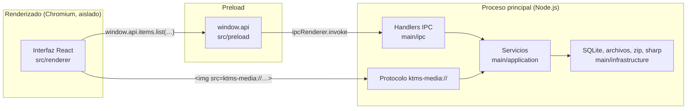

# Arquitectura

[English](ARCHITECTURE.md) | **Español**

Cómo está organizada KeepToMyShelf y por qué. Los motivos de cada decisión, y las alternativas descartadas, están en los [registros de decisiones de arquitectura](adr/) (ADR); este documento es el mapa.

## Electron en pocas palabras

Una aplicación Electron se ejecuta en varios procesos:

- El **proceso principal** (`src/main/`) es un programa de Node.js. Abre la ventana y es la única parte que toca el disco: bases de datos, archivos de imagen, copias de seguridad y diálogos de archivos.
- El **proceso de renderizado** (`src/renderer/`) es la página que muestra la ventana: una app de React que se ejecuta en Chromium, como una web. **No tiene acceso** a Node.js ni al disco.
- El **script de preload** (`src/preload/`) se ejecuta antes de cargar la página. Es el único puente entre ambos: expone una API pequeña como `window.api`, y cada método envía un mensaje al proceso principal (**IPC**, comunicación entre procesos).



## Capas

| Carpeta                    | Contiene                                                                                                    | Puede importar                     |
| -------------------------- | ----------------------------------------------------------------------------------------------------------- | ---------------------------------- |
| `src/core/`                | Reglas de negocio puras: fechas parciales, normalización de texto, valoraciones, filtros, nombres, errores. | Nada de Electron ni de Node.js     |
| `src/shared/`              | El contrato IPC (`ipc.ts`), sus esquemas zod (`ipc-schemas.ts`) y los tipos que usan los dos lados.         | `core`                             |
| `src/main/application/`    | Servicios: uno por área (perfiles, elementos, catálogos, multimedia, colecciones, fondos, copias…).         | `core`, `shared`, `infrastructure` |
| `src/main/infrastructure/` | Bases de datos y migraciones, almacenamiento de archivos, procesado de imágenes, zip, rutas de datos.       | `core`, `shared`                   |
| `src/main/ipc/`            | Handlers finos: validan la entrada y llaman a un servicio.                                                  | Todo lo de `main`                  |
| `src/preload/`             | El puente. Solo puede importar **tipos** (lo impone una regla de ESLint).                                   | Tipos de `shared`                  |
| `src/renderer/`            | La interfaz React, por funciones (`features/library`, `features/items`…).                                   | `core`, `shared`; nunca `main`     |

`core` contiene las reglas que necesitan los dos lados (por ejemplo, validar una fecha en el formulario antes de enviarla, y otra vez en el proceso principal). Es la capa con más pruebas.

## Arranque

[`src/main/index.ts`](../src/main/index.ts):

1. **Elige la carpeta de datos** antes de que Electron esté listo: la portable si existe `KeepToMyShelf Data` junto al `.exe`, la de las pruebas si está definida `KTMS_USER_DATA_DIR`, o `%APPDATA%\KeepToMyShelf` si no.
2. Toma el **bloqueo de instancia única**: una segunda copia de la app solo trae al frente la primera ventana, porque dos procesos escribiendo la misma base de datos podrían dañarla.
3. Abre `app.db` (migrándola si hace falta), crea los servicios, limpia lo que dejó una ejecución interrumpida (importaciones, copias o restauraciones a medias), registra los handlers IPC y el protocolo `ktms-media://`, rechaza todos los permisos web y abre la ventana.

## IPC: cómo funciona una llamada

Ejemplo: la biblioteca pide la lista de videojuegos.

1. **Renderizado:** `useLoad(() => window.api.items.list({ token, kind, sort, … }), [...])` en [`LibraryScreen.tsx`](../src/renderer/features/library/LibraryScreen.tsx).
2. **Preload:** lo reenvía con `ipcRenderer.invoke('items:list', input)`. No añade lógica.
3. **Principal, [`register-handlers.ts`](../src/main/ipc/register-handlers.ts):** comprueba que el mensaje viene de la página de la app (si no, `ipc.forbidden_sender`).
4. **[`create-handler.ts`](../src/main/ipc/create-handler.ts):** valida la entrada con su esquema zod (si no, `ipc.invalid_input`), ejecuta el servicio y envuelve el resultado en un `IpcResult`:
   - `{ ok: true, value }` si todo va bien;
   - `{ ok: false, error: { code, message } }` para un error esperado (un `AppError` de `core/errors.ts`, con un código como `item.not_found`);
   - `{ ok: false, error: { code: 'internal' } }` para cualquier imprevisto, que se registra completo en el proceso principal y nunca llega en detalle a la interfaz.
5. **Renderizado:** `unwrap` ([`lib/ipc.ts`](../src/renderer/lib/ipc.ts), al que llama `useLoad`) devuelve el valor o lanza un `IpcError`; `errorMessage` traduce su código con la clave `errors.<código>` de `es.json` y `en.json`.

La lista de canales es `IpcChannels`, en [`shared/ipc.ts`](../src/shared/ipc.ts), y `KeepToMyShelfApi` da tipo a cada método. El proceso principal también envía dos **eventos** sin que se los pidan (`IpcEvents`): el progreso de las copias de seguridad y los cambios de pantalla completa.

## Perfiles y sesiones

- **`app.db`** guarda los perfiles, las preferencias (un valor global y el propio de cada perfil) y la galería común de fondos.
- **Cada perfil tiene su propia `library.db`**, además de su carpeta `media`. Los perfiles no comparten nada más.
- **Solo hay un perfil abierto a la vez.** Al abrirlo se obtiene un **token de sesión**, y cada llamada sobre datos de la biblioteca debe enviarlo. Un token de una sesión anterior se rechaza (`session.stale`), así que una llamada tardía nunca puede escribir en otro perfil durante un cambio.
- La primera vez que se abre un perfil recibe los **catálogos iniciales** (plataformas, géneros, países…) en su idioma. Una marca en `library_meta` indica que cada lista ya se cargó.

Detalles: [ADR 0003](adr/0003-profiles.md) y [ADR 0004](adr/0004-catalogs.md).

## Bases de datos y migraciones

- **SQLite con better-sqlite3**, que es síncrono: sencillo, rápido para una app local, y las transacciones son funciones normales. El modo WAL y las claves foráneas están activados.
- **El SQL siempre usa parámetros.** La consulta de la biblioteca, cuyos filtros construyen SQL dinámico, usa **Kysely** solo para generarlo ([`item-query.ts`](../src/main/infrastructure/db/item-query.ts)); lo ejecuta better-sqlite3.
- **Migraciones:** archivos SQL numerados en `infrastructure/db/migrations/app/` y `…/library/`, enumerados en su `index.ts`. La versión del esquema es el `user_version` de SQLite.
  - Solo hacia delante. **Una migración que ya está en `main` nunca se modifica.**
  - Cada una se ejecuta en su propia transacción, con las claves foráneas desactivadas (para poder rehacer una tabla) y un `foreign_key_check` antes de confirmar.
  - Antes de migrar una base de datos que ya tiene datos, se guarda una copia en su carpeta `backups` (se conservan las 5 más recientes).
  - Una base de datos de una versión más nueva de la app no se abre (`DatabaseTooNewError`), así que nunca se puede dañar.

Detalles: [ADR 0002](adr/0002-database-migrations.md).

## Imágenes y documentos

- **Almacenamiento por contenido:** cada archivo se guarda con su hash SHA-256 como nombre, así que una imagen añadida dos veces se guarda una sola. `media/files/` contiene los archivos que usan los elementos; `media/originals/`, los originales guardados junto a una copia optimizada.
- **Las importaciones se preparan primero** (en una carpeta temporal, con su miniatura) y solo pasan a formar parte del elemento al guardar el formulario, en la misma transacción que el resto del elemento. Cancelar las descarta.
- **La base de datos manda:** primero se borra la fila, y después un barrido elimina los archivos que ninguna fila usa. Un archivo borrado a mano solo muestra un aviso discreto.
- **Las imágenes** se comprueban por su contenido (JPEG, PNG, WebP, AVIF, GIF; SVG se rechaza), se optimizan a WebP con sharp y tienen miniaturas de 320 y 640 px. **Los documentos PDF** se guardan tal cual y se abren con el visor del sistema, siempre desde una copia temporal.
- **La interfaz nunca lee archivos.** Muestra las imágenes con el protocolo propio `ktms-media://` ([`media-protocol.ts`](../src/main/media-protocol.ts)), que solo sirve, por su hash, imágenes del perfil abierto y de la galería de fondos. Nunca sirve documentos ni usa rutas `file://`.

Detalles: [ADR 0005](adr/0005-media.md) y, para los fondos, [ADR 0008](adr/0008-backgrounds.md).

## Búsqueda y filtros

- Los filtros son un **árbol de expresiones** (grupos Y/O de condiciones) en [`core/filters/`](../src/core/filters/). Un **registro de campos** (`FILTER_FIELDS`) describe cada filtro; el motor de consultas sabe filtrar cada tipo de campo, así que un campo nuevo de un tipo existente es solo un descriptor más.
- Los títulos se buscan en columnas normalizadas (`title_norm`: en minúsculas y sin tildes).
- La cuadrícula de la biblioteca está **virtualizada** (TanStack Virtual): solo existen las tarjetas visibles, y se prueba con 10 000 elementos.

Detalles: [ADR 0006](adr/0006-search-and-filters.md).

## Interfaz

- **React 19**, sin router ni librerías de estado: la navegación es una pila de pantallas ([`app/navigation.ts`](../src/renderer/app/navigation.ts)), los formularios tienen su propio estado, los datos se cargan con un pequeño hook `useLoad` y los diálogos son elementos `<dialog>` nativos.
- **Carpetas por función** en `src/renderer/features/`. La lógica que se puede probar sin React está en archivos `.ts` normales junto a los componentes (`library-view.ts`, `item-form.ts`…).
- **i18next** con `src/renderer/i18n/locales/es.json` y `en.json`. El idioma cambia al momento, sin recargar.
- **Tema y fondo:** variables CSS para el tema claro y el oscuro; el fondo es una capa con desenfoque y un velo debajo de la interfaz.

## Copias de seguridad

Una copia es un `.zip` con una instantánea de la base de datos del perfil (`VACUUM INTO`), sus archivos de `media`, sus preferencias propias y un manifiesto con el SHA-256 de cada archivo. Las miniaturas se regeneran. Al restaurar se comprueba todo (rutas contra una lista cerrada, CRC-32 y SHA-256, `integrity_check`, versión del esquema) en una carpeta temporal antes de sustituir nada. Detalles: [ADR 0009](adr/0009-backups.md).

## Datos en disco

```
%APPDATA%\KeepToMyShelf\         (o "KeepToMyShelf Data\" en la versión portable)
├─ app.db                        perfiles y preferencias
├─ window-state.json             tamaño, posición, maximizada y pantalla completa de la ventana
├─ backgrounds\                  fondos importados, comunes a todos los perfiles
│  ├─ files\  originals\         fondos y los originales guardados
│  ├─ .tmp\                      importaciones en preparación; se vacía al arrancar
│  └─ cache\thumbs\              miniaturas (se pueden regenerar)
├─ backups\                      copias automáticas de perfiles (las 10 últimas) y copias de app.db antes de migrar
│  └─ .tmp\                      instantánea de la copia en curso
├─ profiles\.restoring-<uuid>\   copia que se está restaurando; se borra al terminar y al arrancar
└─ profiles\<uuid>\
   ├─ library.db                 la biblioteca del perfil
   ├─ backups\                   copias antes de migrar (las 5 últimas)
   ├─ media\files\               archivos que usan los elementos
   ├─ media\originals\           originales guardados junto a una copia optimizada
   └─ cache\thumbs\              miniaturas (se pueden regenerar)

%TEMP%\KeepToMyShelf\
└─ opened-documents\<id>\        copias de los PDF abiertos en el visor del sistema
```

Las pruebas automáticas usan siempre una carpeta temporal (`KTMS_USER_DATA_DIR`).

## Seguridad

- La ventana funciona con `contextIsolation`, `sandbox` y sin `nodeIntegration`, y una **CSP** estricta solo permite los scripts de la propia app y las imágenes de `ktms-media:`. La app nunca se conecta a internet.
- Cada mensaje IPC se comprueba (remitente y esquema zod). Se rechazan todos los permisos web (cámara, ubicación…), no se puede abrir ninguna ventana nueva ni `<webview>`, y se bloquea la navegación fuera de la página.
- Los **fusibles** grabados en el `.exe` empaquetado desactivan `ELECTRON_RUN_AS_NODE` y `NODE_OPTIONS` y comprueban la integridad de `app.asar`.

Detalles: [ADR 0011](adr/0011-security.md).

## Empaquetado y publicación

electron-builder genera un instalador NSIS por usuario, y `scripts/package-portable.mjs` genera el `.zip` portable. La app es portable cuando existe una carpeta `KeepToMyShelf Data` junto a su `.exe`. El workflow `release.yml` compila, prueba y crea el borrador de cada versión. Detalles: [ADR 0010](adr/0010-distribution.md) y [RELEASING.es.md](RELEASING.es.md).

## Registros de decisiones

| ADR                                     | Tema                                    |
| --------------------------------------- | --------------------------------------- |
| [0001](adr/0001-stack.md)               | Electron + TypeScript + React + SQLite  |
| [0002](adr/0002-database-migrations.md) | Esquema de base de datos y migraciones  |
| [0003](adr/0003-profiles.md)            | Perfiles, sesiones y preferencias       |
| [0004](adr/0004-catalogs.md)            | Catálogos y relaciones                  |
| [0005](adr/0005-media.md)               | Almacenamiento de imágenes y documentos |
| [0006](adr/0006-search-and-filters.md)  | Búsqueda, filtros y ordenación          |
| [0007](adr/0007-collections.md)         | Colecciones                             |
| [0008](adr/0008-backgrounds.md)         | Fondos de pantalla                      |
| [0009](adr/0009-backups.md)             | Copias de seguridad de los perfiles     |
| [0010](adr/0010-distribution.md)        | Distribución en Windows                 |
| [0011](adr/0011-security.md)            | Seguridad de la aplicación              |
