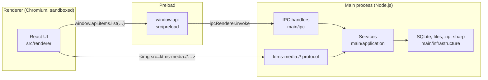

# Architecture

**English** | [Español](ARCHITECTURE.es.md)

How KeepToMyShelf is organized and why. The reasons behind each decision, and the alternatives that were discarded, are in the [architecture decision records](adr/) (in Spanish); this document is the map.

## Electron in brief

An Electron app runs as several processes:

- The **main process** (`src/main/`) is a Node.js program. It opens the window and is the only part that touches the disk: databases, image files, backups and file dialogs.
- The **renderer process** (`src/renderer/`) is the page shown in the window: a React app running in Chromium, like a website. It has **no access** to Node.js or the disk.
- The **preload script** (`src/preload/`) runs before the page loads. It is the only bridge between both: it exposes a small API as `window.api`, and each method sends one message to the main process (**IPC**, inter-process communication).



## Layers

| Folder                     | Contains                                                                                       | May import                         |
| -------------------------- | ---------------------------------------------------------------------------------------------- | ---------------------------------- |
| `src/core/`                | Pure business rules: partial dates, text normalization, ratings, filters, names, errors.       | Nothing from Electron or Node.js   |
| `src/shared/`              | The IPC contract (`ipc.ts`), its zod schemas (`ipc-schemas.ts`) and the types both sides use.  | `core`                             |
| `src/main/application/`    | Services: one per area (profiles, items, catalogs, media, collections, backgrounds, backups…). | `core`, `shared`, `infrastructure` |
| `src/main/infrastructure/` | Databases and migrations, file storage, image processing, zip files, data paths.               | `core`, `shared`                   |
| `src/main/ipc/`            | Thin handlers: validate the input and call a service.                                          | Everything in `main`               |
| `src/preload/`             | The bridge. It may only import **types** (an ESLint rule enforces it).                         | Types from `shared`                |
| `src/renderer/`            | The React UI, by feature (`features/library`, `features/items`…).                              | `core`, `shared`; never `main`     |

`core` holds the rules both sides need (for example, validating a date in the form before sending it, and again in the main process). It is the most tested layer.

## Startup

[`src/main/index.ts`](../src/main/index.ts):

1. **Chooses the data folder** before Electron is ready: the portable folder if `KeepToMyShelf Data` exists next to the `.exe`, the test folder if `KTMS_USER_DATA_DIR` is set, or `%APPDATA%\KeepToMyShelf` otherwise.
2. Takes the **single-instance lock**: a second copy of the app only brings the first window to the front, because two processes writing the same database could corrupt it.
3. Opens `app.db` (migrating it if needed), creates the services, cleans up what an interrupted run left behind (half-done imports, backups or restores), registers the IPC handlers and the `ktms-media://` protocol, denies all web permissions and opens the window.

## IPC: how a call works

Example: the library asks for the list of games.

1. **Renderer:** `useLoad(() => window.api.items.list({ token, kind, sort, … }), [...])` in [`LibraryScreen.tsx`](../src/renderer/features/library/LibraryScreen.tsx).
2. **Preload:** forwards it with `ipcRenderer.invoke('items:list', input)`. It adds no logic.
3. **Main, [`register-handlers.ts`](../src/main/ipc/register-handlers.ts):** checks that the message comes from the app's own page (otherwise `ipc.forbidden_sender`).
4. **[`create-handler.ts`](../src/main/ipc/create-handler.ts):** validates the input with its zod schema (otherwise `ipc.invalid_input`), runs the service and wraps the outcome in an `IpcResult`:
   - `{ ok: true, value }` on success;
   - `{ ok: false, error: { code, message } }` for an expected error (an `AppError` from `core/errors.ts`, with a code such as `item.not_found`);
   - `{ ok: false, error: { code: 'internal' } }` for anything unexpected, which is logged in full in the main process and never reaches the UI in detail.
5. **Renderer:** `unwrap` ([`lib/ipc.ts`](../src/renderer/lib/ipc.ts), which `useLoad` calls) returns the value or throws an `IpcError`; `errorMessage` translates its code with the key `errors.<code>` in `es.json` and `en.json`.

The channel list is `IpcChannels` in [`shared/ipc.ts`](../src/shared/ipc.ts), and `KeepToMyShelfApi` types every method. The main process also sends three **events** without being asked (`IpcEvents`): backup progress, a failed scheduled backup and full-screen changes.

## Profiles and sessions

- **`app.db`** holds the profiles, the preferences (a global value and each profile's own) and the common background gallery.
- **Each profile has its own `library.db`**, plus its `media` folder. Profiles share nothing else. The only read across profiles is copying catalogs: the main process opens the other `library.db` read-only.
- **Only one profile is open at a time.** Opening it returns a **session token**, and every call about library data must send it. A token from a previous session is rejected (`session.stale`), so a late call can never write into another profile while switching.
- The first time a profile opens, it receives the **default catalogs** (platforms, genres, countries…) in its language. A flag in `library_meta` marks each list as loaded.

Details: [ADR 0003](adr/0003-profiles.md) and [ADR 0004](adr/0004-catalogs.md).

## Databases and migrations

- **SQLite with better-sqlite3**, which is synchronous: simple, fast for a local app, and transactions are plain functions. WAL mode and foreign keys are on.
- **SQL is always parameterized.** The library query, whose filters build SQL dynamically, uses **Kysely** only to generate it ([`item-query.ts`](../src/main/infrastructure/db/item-query.ts)); better-sqlite3 runs it.
- **Migrations** are numbered SQL files in `infrastructure/db/migrations/app/` and `…/library/`, listed in their `index.ts`. The schema version is SQLite's `user_version`.
  - Forward only. **A migration that is already in `main` is never edited.**
  - Each one runs in its own transaction, with foreign keys off (so a table can be rebuilt) and a `foreign_key_check` before committing.
  - Before migrating a database that already has data, a copy is saved in its `backups` folder (the 5 most recent are kept).
  - A database from a newer version of the app is not opened (`DatabaseTooNewError`), so it can never be damaged.

Details: [ADR 0002](adr/0002-database-migrations.md).

## Images and documents

- **Content-addressed storage:** each file is saved under its SHA-256 hash, so the same image added twice is stored once. `media/files/` holds the files items use; `media/originals/` holds the originals kept next to an optimized copy.
- **Imports are prepared first** (in a temporary folder, with their thumbnail) and become part of the item only when the form is saved, in the same transaction as the rest of the item. Cancelling discards them.
- **The database rules:** a row is deleted first, and a sweep later removes the files no row uses. A file deleted by hand only shows a discreet notice.
- **Images** are checked by their content (JPEG, PNG, WebP, AVIF, GIF; SVG is rejected), optimized with sharp to WebP, and get thumbnails of 320 and 640 px. **PDF documents** are stored as they are and opened with the system viewer, always from a temporary copy.
- **Drag and drop** (an item's cover, gallery and documents): the UI only hands the dropped `File` objects to the preload; the preload gets their paths with `webUtils.getPathForFile`, and the main process refuses network paths and anything that is not an ordinary file before preparing them like those from the dialog ([ADR 0011](adr/0011-security.md#arrastrar-y-soltar-v11-e)).
- **The UI never reads files.** It shows images through the custom protocol `ktms-media://` ([`media-protocol.ts`](../src/main/media-protocol.ts)), which only serves images of the open profile and of the background gallery, by hash. It never serves documents and never uses `file://` paths.

Details: [ADR 0005](adr/0005-media.md) and, for backgrounds, [ADR 0008](adr/0008-backgrounds.md).

## Search and filters

- The filters are an **expression tree** (AND/OR groups of conditions) in [`core/filters/`](../src/core/filters/). A **field registry** (`FILTER_FIELDS`) describes each filter; the query engine knows how to filter each type of field, so a new field of an existing type is just a new descriptor.
- Titles are searched through normalized columns (`title_norm`: lower case, no accents).
- Titles and names (catalogs, collections and profiles) are sorted with **numbers by value** ("Final Fantasy 2" before "Final Fantasy 10"), through the `natural_key` SQL function that every connection registers in [`connection.ts`](../src/main/infrastructure/db/connection.ts).
- The library grid is **virtualized** (TanStack Virtual): only the visible cards exist, and it is tested with 10,000 items.

Details: [ADR 0006](adr/0006-search-and-filters.md).

## User interface

- **React 19** without a router or state libraries: navigation is a stack of screens ([`app/navigation.ts`](../src/renderer/app/navigation.ts)), forms keep their own state, data is loaded with a small `useLoad` hook, and dialogs are native `<dialog>` elements.
- **Feature folders** in `src/renderer/features/`. Logic that can be tested without React lives in plain `.ts` files next to the components (`library-view.ts`, `item-form.ts`…).
- **i18next** with `src/renderer/i18n/locales/es.json` and `en.json`. The language changes instantly, without reloading.
- **Theme and background:** CSS variables for light and dark; the background is a layer with blur and a veil below the UI.

## Backups

A backup is a `.zip` with a snapshot of the profile's database (`VACUUM INTO`), its `media` files, its own preferences and a manifest with the SHA-256 of each file. Thumbnails are regenerated. Scheduled backups are made by the app itself, in the background, after a profile is opened; they give way to any backup or restore the user asks for. Restoring checks everything (paths against a closed list, CRC-32 and SHA-256, `integrity_check`, schema version) in a temporary folder before replacing anything. Details: [ADR 0009](adr/0009-backups.md).

## Export and import

The library is exported to a versioned JSON file (items, catalogs and collections, by UUID and by name, without internal ids) or, by kind, to a CSV file for spreadsheets. The CSV columns and the guard against formulas are in `core/export/`. Details: [ADR 0012](adr/0012-export.md).

An exported JSON file is imported into the open profile by adding only: items and collections are recognized by their UUID, and catalog values by their exact name. `core/import/` decides what is added, with the same rules as the item form, and the main process writes it in a single transaction, after an automatic backup. A CSV file with the columns of the export is read in `core/import/` (`csv-parse.ts` and `csv-import.ts`), which turns each row into an item with a new UUID and adds it with the same rules as the JSON file. Details: [ADR 0013](adr/0013-import.md).

## Data on disk

```
%APPDATA%\KeepToMyShelf\         (or "KeepToMyShelf Data\" in the portable version)
├─ app.db                        profiles and preferences
├─ window-state.json             window size, position, maximized and full screen
├─ backgrounds\                  imported backgrounds, common to every profile
│  ├─ files\  originals\         backgrounds and their kept originals
│  ├─ .tmp\                      imports being prepared; emptied at startup
│  └─ cache\thumbs\              thumbnails (can be regenerated)
├─ backups\                      automatic profile backups (last 10) and copies of app.db before migrating
│  ├─ scheduled\<uuid>\          scheduled backups of each profile (last 10)
│  └─ .tmp\                      snapshot of the backup in progress
├─ profiles\.restoring-<uuid>\   backup being restored; removed when done and at startup
└─ profiles\<uuid>\
   ├─ library.db                 the profile's library
   ├─ backups\                   copies before migrating (last 5)
   ├─ media\files\               files the items use
   ├─ media\originals\           originals kept next to an optimized copy
   └─ cache\thumbs\              thumbnails (can be regenerated)

%TEMP%\KeepToMyShelf\
└─ opened-documents\<id>\        copies of the PDFs opened in the system viewer
```

Automated tests always use a temporary folder (`KTMS_USER_DATA_DIR`).

## Security

- The window runs with `contextIsolation`, `sandbox` and without `nodeIntegration`, and a strict **CSP** only allows the app's own scripts and `ktms-media:` images. The app never connects to the internet.
- Every IPC message is checked (sender and zod schema). All web permissions (camera, location…) are denied, no new window or `<webview>` can open, and navigation away from the page is blocked.
- **Fuses** burnt into the packaged `.exe` disable `ELECTRON_RUN_AS_NODE` and `NODE_OPTIONS` and check the integrity of `app.asar`.

Details: [ADR 0011](adr/0011-security.md).

## Packaging and releases

electron-builder makes a per-user NSIS installer, and `scripts/package-portable.mjs` makes the portable `.zip`. The app is portable when a `KeepToMyShelf Data` folder exists next to its `.exe`. The `release.yml` workflow builds, tests and drafts each release. Details: [ADR 0010](adr/0010-distribution.md) and [RELEASING.md](RELEASING.md).

## Decision records

| ADR                                     | Topic                                  |
| --------------------------------------- | -------------------------------------- |
| [0001](adr/0001-stack.md)               | Electron + TypeScript + React + SQLite |
| [0002](adr/0002-database-migrations.md) | Database schema and migrations         |
| [0003](adr/0003-profiles.md)            | Profiles, sessions and preferences     |
| [0004](adr/0004-catalogs.md)            | Catalogs and relations                 |
| [0005](adr/0005-media.md)               | Image and document storage             |
| [0006](adr/0006-search-and-filters.md)  | Search, filters and sorting            |
| [0007](adr/0007-collections.md)         | Collections                            |
| [0008](adr/0008-backgrounds.md)         | Backgrounds                            |
| [0009](adr/0009-backups.md)             | Profile backups                        |
| [0010](adr/0010-distribution.md)        | Distribution on Windows                |
| [0011](adr/0011-security.md)            | Application security                   |
| [0012](adr/0012-export.md)              | Exporting the library                  |
| [0013](adr/0013-import.md)              | Importing the library                  |
